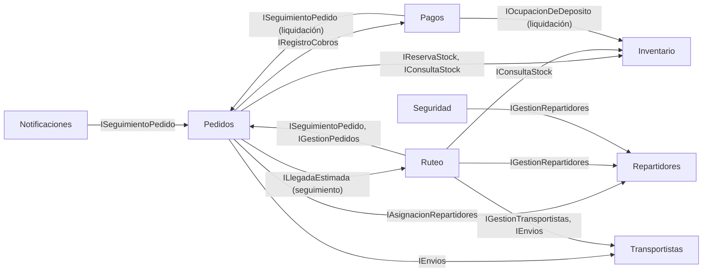
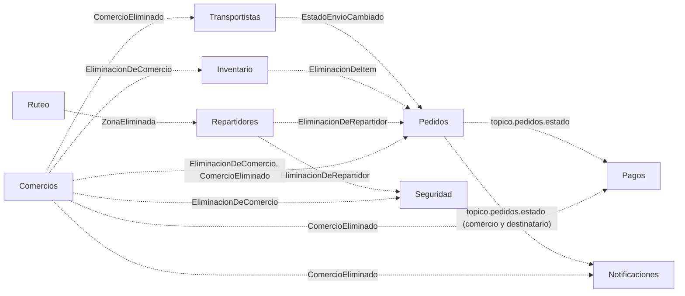
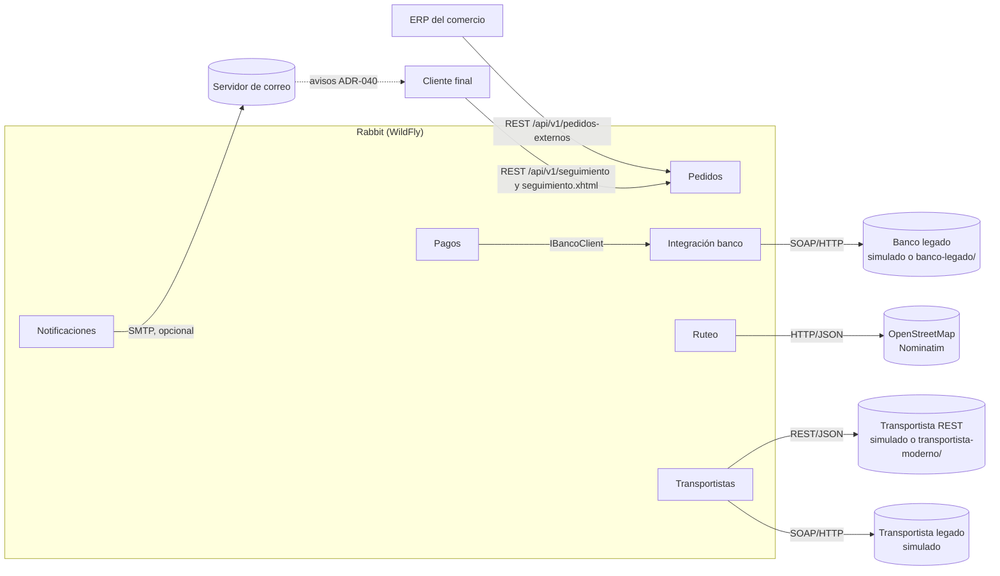
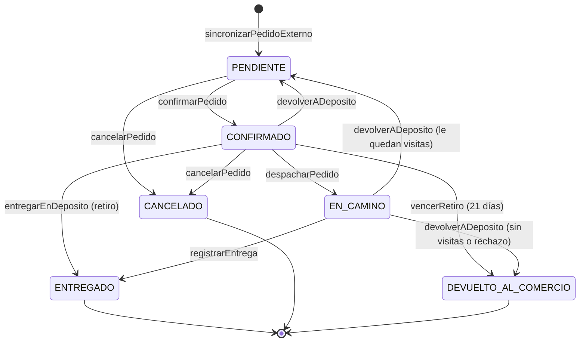

# Arquitectura

## Capas

Cada componente se organiza en tres capas con dependencia en un solo
sentido: **Presentación → Negocio → Datos**.

- **Presentación**
  - Tecnología: JSF (`@Named` + `@ViewScoped`), Facelets
  - Responsabilidad: Mostrar y capturar datos. Sin reglas de negocio.
  - Paquete: `presentacion/`
- **Negocio**
  - Tecnología: EJB (`@Stateless`, `@Stateful`, `@Singleton`, `@MessageDriven`)
  - Responsabilidad: Reglas del dominio, transacciones, seguridad, orquestación entre componentes
  - Paquete: `negocio/`
- **Datos**
  - Tecnología: JPA / Hibernate
  - Responsabilidad: Persistencia. Única capa que toca el `EntityManager`
  - Paquete: `datos/`, `datos/model/`
- **(transversal)**
  - Tecnología: POJOs
  - Responsabilidad: Objetos que cruzan capas y componentes
  - Paquete: `dto/`

**Por qué así:** la vista nunca ve entidades JPA (así se evitan la
`LazyInitializationException` y que la vista quede acoplada al esquema), y las reglas
viven en un solo lugar (el EJB), sin importar si las invoca una pantalla,
un timer o un MDB.

## Componentes

Rabbit tiene **9 componentes de negocio**. El ítem "Integración banco
legado" es la capa técnica `integracion` (cliente SOAP del banco y
adaptadores de transportistas): tiene interfaces `@Local` (`IBancoClient`)
pero no es un componente de negocio.

Cada componente expone interfaces `@Local` separadas por uso (lectura vs.
escritura) y nunca expone sus entidades ni sus excepciones internas a
otro componente. Las referencias entre componentes se guardan como IDs
(`Long idComercio`), no como relaciones JPA.

- **Comercios**
  - Estado: Implementado
  - Interfaces: `IRegistroComercios`, `IConsultaComercios`
  - Tipo de EJB: `@Stateless`
  - Por qué ese tipo: Cada operación recibe todo lo que necesita; el estado vive en la base
- **Inventario**
  - Estado: Implementado
  - Interfaces: `IConsultaStock`, `IReservaStock`, `IRecepcionDeMercaderia` (ADR-058), `IOcupacionDeDeposito` (ADR-059)
  - Tipo de EJB: `@Stateful` (`InventarioService`, `IReservaStock`) + `@Stateless` (`ConsultaStockService`, `IConsultaStock`)
  - Por qué ese tipo: La reserva es una conversación: `reservarStock` y `confirmarReserva` operan sobre la misma instancia
- **Pedidos**
  - Estado: Implementado
  - Interfaces: `IGestionPedidos`, `ISeguimientoPedido`, `IIndicadores` (ADR-044)
  - Tipo de EJB: `@Stateless` (Facade)
  - Por qué ese tipo: El estado del pedido vive en la base; ninguna operación depende de una llamada anterior
- **Seguridad**
  - Estado: Implementado
  - Interfaces: `IRegistroUsuarios`, `IConsultaUsuarios`, `IContextoUsuario`
  - Tipo de EJB: `@Stateless`
  - Por qué ese tipo: Idem Comercios
- **Integración banco legado (capa técnica, no componente de negocio)**
  - Estado: Implementado
  - Interfaces: `IBancoClient` (`autorizar`, `autorizarReferencia`, `reversar`)
  - Tipo de EJB: `@Stateless` + `@Singleton` (`CircuitBreakerBanco`)
  - Por qué ese tipo: Cliente SOAP sin estado de conversación; el estado del circuit breaker es uno solo, compartido por todas las llamadas
- **Pagos y Cobranzas**
  - Estado: Implementado
  - Interfaces: `IRegistroCobros`, `IConsultaCobros`, `ILiquidaciones` (ADR-034)
  - Tipo de EJB: `@Stateless` + `@MessageDriven` (suscriptor) + `@Singleton` (`LiquidacionMensual`, timer)
  - Por qué ese tipo: El cobro queda registrado en la base; se suma a la transacción del llamador
- **Repartidores**
  - Estado: Implementado
  - Interfaces: `IAsignacionRepartidores`, `IGestionRepartidores`
  - Tipo de EJB: `@Stateless`
  - Por qué ese tipo: La disponibilidad del repartidor es un dato persistido, no de sesión
- **Notificaciones**
  - Estado: Implementado
  - Interfaces: `INotificaciones`, `IAvisosAlDestinatario` (ADR-040)
  - Tipo de EJB: `@Stateless` + `@MessageDriven` (dos de los tres suscriptores del tópico: comercio y destinatario; el tercero es Pagos)
  - Por qué ese tipo: Reacciona a eventos del tópico; nadie la llama para avisar
- **Ruteo**
  - Estado: Implementado
  - Interfaces: `IRuteo`, `IZonas`, `ILlegadaEstimada` (ADR-043)
  - Tipo de EJB: `@Stateless` (`LlegadaEstimadaService` con `@RunAs`)
  - Por qué ese tipo: Arma cada hoja de ruta de cero con lo que está en la base; las zonas son datos persistidos y el despacho no depende de una llamada anterior
- **Transportistas**
  - Estado: Implementado
  - Interfaces: `IGestionTransportistas`, `IEnvios`, `ISeguimientoEnvios`
  - Tipo de EJB: `@Stateless` + `@Singleton` (`SeguimientoDeEnvios`, timer)
  - Por qué ese tipo: El estado de cada envío vive en la base; el seguimiento es una sola tarea periódica

### Operaciones por componente (implementado)

- **Comercios**
  - `IRegistroComercios`
    - Operaciones: `registrarComercio`, `actualizarDatosFiscales`, `darDeBajaComercio`, `reactivarComercio`, `eliminarComercio`, `registrarPuntoPicking`, `darDeBajaPuntoPicking`, `reactivarPuntoPicking`
    - Quién la usa: `ComercioBean`, `PuntoPickingBean`
  - `IConsultaComercios`
    - Operaciones: `obtenerComercio`, `listarTodos`, `listarPuntosPicking`, `listarPuntosPickingDeComercio`, `validarComercioActivo`
    - Quién la usa: Vistas, Inventario, Pedidos, Ruteo, Seguridad (`UsuarioService`, `SesionBean`)
- **Inventario**
  - `IConsultaStock`
    - Operaciones: `registrarDeposito`, `listarDepositos`, `obtenerDeposito`, `listarDepositosConStock`, `registrarItem`, `actualizarItem`, `eliminarItem` (solo administrador, ADR-049), `listarItemsPorDeposito`, `listarItemsPorComercio`, `listarItemsPorComercioYDeposito`, `listarItemsPorIds`, `pesosPorItem` (sin rol, ADR-032), `listarStockDelComercioActual`, `consultarDisponibilidad`, `listarHistorialReservas`, `depositosPorItem`, `marcarBaseDeSalida`
    - Quién la usa: `DepositoBean`, `ItemInventarioBean`, `HistorialReservasBean`, `PedidoBean`, `PortalComercioBean`, Pedidos, Ruteo
  - `IReservaStock`
    - Operaciones: `reservarStock`, `confirmarReserva`, `liberarReserva`, `extenderReserva`, `obtenerReservaActual`, `hayReservaVigente`, `registrarDevolucion`
    - Quién la usa: `ReservaBean`, Pedidos
  - `IRecepcionDeMercaderia` (ADR-058)
    - Operaciones: `anunciar` (el comercio anuncia la mercadería que va a mandar), `registrarRecepcion` (el personal la recibe y la suma al stock, con la fecha de ingreso de ADR-065), `contarAnunciadas`, `listarDelComercioActual`, `listarTodas`, `obtener`
    - Quién la usa: las pantallas de recepción del comercio y del personal
  - `IOcupacionDeDeposito` (ADR-059 y ADR-065)
    - Operaciones: `tomarFoto` (la foto diaria de las 23:55: unidades por categoría, cuántas gratis y cuántas con recargo), `ocupacionDelMes`, `ocupacionDelMesDelComercioActual`, `fechaDeLaUltimaFoto`
    - Quién la usa: Pagos (la liquidación mensual) y la pantalla de liquidaciones
- **Pedidos**
  - `IGestionPedidos`
    - Operaciones: `registrarPedidoExterno`, `cancelarPedidoExterno`, `sincronizarPedidoExterno`, `descartarPedidoExterno`, `confirmarPedido`, `confirmarPedidoEnZona` (null = quedó en lista de espera), `asignarDesdeEspera`, `sacarDeEspera`, `devolverADeposito` (motivo fijo e intentos: ADR-037 y 041), `listarIntentosDeEntrega` y `obtenerFotoDeVisita` (evidencia de cada visita, ADR-045), `derivarATransportista`, `cotizarDerivacion`, `despacharPedido`, `registrarEntrega` (con remito: ADR-033), `registrarEntregaDeTransportista`, `obtenerRemito`, `cancelarPedido`, `entregarEnDeposito`, `idsDeRetirosVencidos` y `vencerRetiro` (retiro en depósito y su vencimiento a los 21 días, ADR-053)
    - Quién la usa: `PedidoBean`, `MisEntregasBean`, `RemitoServlet`, Ruteo, MDB, timer
  - `ISeguimientoPedido`
    - Operaciones: `listarPedidosExternos`, `consultarPedidoExterno`, `consultarEstadoPedido`, `consultarSeguimiento`, `consultarCalificacion` y `calificarEntrega` (públicas, ADR-052), `consultarCodigoDeEntrega` y `consultarUbicacionDeEntrega` (ADR-055), `modificarEntrega` (pública, ADR-057), `listarPendientes`, `listarTodos`, `listarPedidosDeComercio`, `listarEntregasEnCurso`, `listarPedidosDelComercioActual`, `listarPedidosDelRepartidorActual`, `listarEntregasEnCursoDeRepartidor` (ADR-043), `resumenEntregas`, `resumenEntregasDelComercioActual` (ADR-034)
    - Quién la usa: `PedidoBean`, `PortalComercioBean`, Ruteo, Pagos, Notificaciones, API REST
  - `IIndicadores`
    - Operaciones: `calcular` (personal: toda la red o un comercio), `calcularDelComercioActual` (ADR-044)
    - Quién la usa: `IndicadoresBean`
- **Seguridad**
  - `IRegistroUsuarios`
    - Operaciones: `registrarUsuario`, `darDeBaja`, `reactivarUsuario`, `restablecerClave` (ADR-031), `eliminarUsuario` (ADR-036)
    - Quién la usa: `UsuarioBean`
  - `IConsultaUsuarios`
    - Operaciones: `listarTodos`, `obtenerUsuario`
    - Quién la usa: `UsuarioBean`
  - `IContextoUsuario`
    - Operaciones: `idComercioActual`, `idRepartidorActual`
    - Quién la usa: Pedidos, Inventario, Comercios, Notificaciones, `SesionBean`
- **Pagos**
  - `IRegistroCobros`
    - Operaciones: `registrarCobro`, `registrarCobroContraEntrega`, `anularCobro` (`ADMINISTRADOR`), `anularCobroPorDevolucion` (sin rol, ADR-041)
    - Quién la usa: Pedidos, `SuscriptorPagosEstadoPedido`
  - `IConsultaCobros`
    - Operaciones: `obtenerCobroDePedido`, `listarTodos`, `listarCobrosDelComercioActual`
    - Quién la usa: `PedidoBean`, `PortalComercioBean`
  - `ILiquidaciones`
    - Operaciones: `liquidarMes`, `previsualizar`, `reintentarCobro`, `reintentarPendientes`, `listarDelPeriodo`, `listarPeriodos`, `listarDelComercioActual`, `previsualizarMesEnCursoDelComercioActual`, `tarifaVigente` (ADR-034)
    - Quién la usa: `LiquidacionBean`, `MisLiquidacionesBean`, `LiquidacionMensual` (timer)
- **Repartidores**
  - `IAsignacionRepartidores`
    - Operaciones: `asignarRepartidor` (zona preferida, peso, bultos y repartidor excluido: ADR-032 y 037), `motivoParaEsperar`, `antesDelCorte`, `diaDeEntregaPara` (fecha prometida, ADR-042), `liberarRepartidor`, `ultimaUbicacion` (ubicación de la visita fallida, ADR-045)
    - Quién la usa: Pedidos
  - `IGestionRepartidores`
    - Operaciones: `registrarRepartidor`, `asignarZona`, `actualizarCapacidad`, `eliminarRepartidor` (ADR-036), `listarTodos`, `obtenerRepartidor`, `registrarUbicacion`, `listarUbicacionesRecientes`, `ubicacionParaPedido` (ADR-035)
    - Quién la usa: `RepartidorBean`, `MapaBean`, `MisEntregasBean`, `SeguimientoBean`, `PedidoBean`, Ruteo, Seguridad
- **Notificaciones**
  - `INotificaciones`
    - Operaciones: `avisarCambioDeEstado`, `listarRecientes`, `listarDelComercioActual`
    - Quién la usa: `SuscriptorNotificacionesEstadoPedido`, `CampanaBean`
  - `IAvisosAlDestinatario`
    - Operaciones: `avisar`, `listarRecientes` (ADR-040)
    - Quién la usa: `SuscriptorDestinatarioEstadoPedido`, `CampanaBean`
- **Ruteo**
  - `IRuteo`
    - Operaciones: `listarEntregasEnCurso`, `entregasEnCursoDelRepartidor`, `recorridoRecomendado` (ADR-038), `recorridoDeRepartidor` (ADR-043), `depositoDeSalida`, `historialDelRepartidor`, `listarPendientesPorZona`, `despacharPedido`, `despacharZona`
    - Quién la usa: `EntregasBean`, `MisEntregasBean`, `RuteoBean`, `LlegadaEstimadaService`
  - `IZonas`
    - Operaciones: `registrarZona`, `darDeBajaZona`, `reactivarZona`, `eliminarZona` (ADR-036), `listarTodas`, `zonaDeCodigoPostal`
    - Quién la usa: `RuteoBean`, `RepartidorBean`, `RuteoService`
  - `ILlegadaEstimada`
    - Operaciones: `estimar` (parada y franja de un pedido en camino, ADR-043)
    - Quién la usa: `SeguimientoBean`, `SeguimientoResource`
- **Transportistas**
  - `IGestionTransportistas`
    - Operaciones: `registrarTransportista`, `darDeBajaTransportista`, `reactivarTransportista`, `listarTodos`, `listarActivos`
    - Quién la usa: `TransportistaBean`, `PedidoBean`, `SeguimientoDeEnvios`
  - `IEnvios`
    - Operaciones: `solicitarEnvio`, `cotizarEnvio`, `cancelarEnvioDePedido`, `listarEnvios`, `listarEnviosDelComercioActual`
    - Quién la usa: Pedidos, Ruteo, `PedidoBean`, `TransportistaBean`, `PortalComercioBean`
  - `ISeguimientoEnvios`
    - Operaciones: `listarEnviosActivos`, `registrarNovedad`
    - Quién la usa: `SeguimientoDeEnvios` (interna del componente)

Otros detalles de cada componente:

- **Inventario:** `IReservaStock` (`InventarioService`, `@Stateful`)
  mantiene la reserva abierta entre requests con `@StatefulTimeout`;
  `BarredorDeReservas` (`@Schedule`) libera las reservas vencidas que el
  usuario no resolvió. Las consultas y la carga de stock (`IConsultaStock`)
  están en `ConsultaStockService` (`@Stateless`): no tienen conversación, y
  así quien solo consulta no queda atado a una instancia stateful que
  puede vencer (ADR-027).
- **Comercios:** eliminar un comercio es físico y solo se permite si ya
  está dado de baja y si nada vivo lo referencia (pedidos en curso o
  entregados, pedidos del ERP sin sincronizar, stock consignado, cuentas
  de usuario): cada componente lo verifica al recibir el evento
  `EliminacionDeComercio`. Si hay referencias, el comercio queda dado de
  baja. Los pedidos cancelados no impiden: con la eliminación decidida,
  `ComercioEliminado` hace que Pedidos, Pagos, Notificaciones y
  Transportistas borren ese historial en la misma transacción (ADR-028).
- **Repartidores, zonas y usuarios:** el administrador también los puede
  eliminar (ADR-036), con el mismo esquema de eventos: Pedidos y
  Seguridad impiden eliminar un repartidor con entregas en curso o con
  cuenta (`EliminacionDeRepartidor`) y después le sueltan la referencia
  (`RepartidorEliminado`); al eliminar una zona, Repartidores deja sin
  zona fija a los suyos (`ZonaEliminada`).
- **Pedidos:** un pedido es multi-línea (`LineaPedido`). Con origen
  `STOCK_CONSIGNADO` cada línea reserva y confirma stock en su propia
  instancia de `IReservaStock`; con `PUNTO_PICKING` solo se valida que el
  punto de picking esté activo. Al cancelar, solo se devuelve el stock de
  las líneas con `idReservaStock`.
- **Seguridad:** `LoginBean` y `SesionBean` toman el usuario y sus roles
  del `SecurityContext` de WildFly. `SesionBean` además usa
  `IContextoUsuario` para saber a qué comercio o repartidor representa la
  cuenta (lo muestra en el menú). `IContextoUsuario` es la pieza que usan
  los demás componentes para filtrar por dueño.
- **Pagos:** PREPAGO se cobra por SOAP en el banco legado al confirmar
  (rechaza por encima de $500.000); si la confirmación falla después, se
  pide la reversa al banco;
  CONTRA_ENTREGA queda PENDIENTE y se acredita al recibir `ENTREGADO` por
  el tópico.
- **Repartidores:** `asignarRepartidor` le da el pedido al primero al que
  le entra (`AsignacionPorCapacidad`; los de la zona primero), con bloqueo
  pesimista para que dos confirmaciones simultáneas no carguen de más al
  mismo repartidor. Se libera al entregar, cancelar o devolver el pedido.
- **Lista de espera (ADR-037):** si no le entra a nadie o ya pasó la hora
  de corte (`HoraDeCorte`: 07:00 por defecto, `rabbit.ruteo.hora-corte` la cambia), el
  pedido queda PENDIENTE con `enEsperaDesde`, sin cobrar.
  `AsignadorDeEspera` (`@Singleton`, `@RunAs("OPERADOR")`) recorre la
  fila cada minuto y apenas un pedido se entrega, cancela o devuelve
  (`AvisosDeEspera`, después del commit).
- **Hoja de ruta recomendada (ADR-038):** `OrdenDeRecorrido` ordena las
  paradas del repartidor (retiros primero, entregas por cercanía de CP) y
  `EnlaceMapa.tramos` arma los links de Google Maps de hasta 10 puntos.
- **Notificaciones:** el aviso queda guardado y se ve en la campana de la
  cabecera (`CampanaBean`, ADR-051): el comercio, los de sus pedidos; el
  personal, los avisos a comercios y a quien recibe; si hay un servidor de
  correo configurado,
  además se le manda por mail (`AvisosPorMail`, después del commit).
  Descarta eventos más viejos que el último avisado del mismo pedido.
- **Transportistas:** un pedido pendiente se puede **derivar** a una
  empresa de envíos externa en lugar de confirmarlo con un repartidor
  propio (`derivarATransportista`). Cada transportista se integra con su
  propia tecnología a través de un Adapter (`IAdaptadorTransportista`:
  REST o SOAP legado) y `SeguimientoDeEnvios` consulta cada 15 s el estado
  de los envíos activos; Pedidos mueve el pedido al recibir el evento
  `EstadoEnvioCambiado`. Detalle en
  [MENSAJERIA-SINCRONICA.md](../integraciones/MENSAJERIA-SINCRONICA.md) y ADR-016.
- **Ruteo:** arma la hoja de ruta de cada pedido: de dónde se retira (el
  punto de picking, o cada depósito del que sale stock consignado), adónde
  se entrega (`direccionEntrega`, que manda el ERP) y cuánto cobrar si es
  contra entrega. Además agrupa los pedidos pendientes por **zona**
  (rangos de código postal, tabla `zonas`) y los despacha según la
  cobertura de la zona: con un repartidor propio de la zona, derivados a
  su transportista, o al transportista de respaldo si no hay repartidores
  libres. Cada pedido se despacha en su propia transacción. Los pedidos
  sin código postal quedan "sin zona" para el despacho manual. En el
  tablero del personal, cada hoja de ruta tiene un link "Ver recorrido en
  el mapa" (Google Maps, sin clave; lo arma `EnlaceMapa`). El repartidor
  ve una hoja de ruta recomendada con todas sus paradas, ordenadas por
  cercanía de código postal y no por distancia real (no hay
  geocodificación), con el recorrido en Google Maps en tramos de hasta 10
  puntos. Ver ADR-017 y ADR-038.

### Dependencias entre componentes (implementadas)

Las dependencias se muestran en tres diagramas: las llamadas entre
componentes, los eventos y las integraciones con sistemas externos.

**Llamadas entre componentes.** Cada flecha es una llamada a una interfaz
`@Local` del otro componente. Para que se lea, no se dibujan dos
interfaces que usan casi todos:

- `IConsultaComercios` (Comercios): la usan Pedidos, Inventario, Ruteo,
  Pagos, Notificaciones y Seguridad.
- `IContextoUsuario` (Seguridad): la usan todos los demás componentes salvo
  Ruteo, para saber a qué comercio o repartidor representa el usuario (ver
  Seguridad más abajo).

**Eventos.** Las flechas punteadas son avisos, no llamadas: quien publica
no depende de quien escucha. El tópico JMS lleva los cambios de estado del
pedido a Pagos y a Notificaciones (dos suscripciones: comercio y
destinatario). Los eventos CDI resuelven el resto:

- `EstadoEnvioCambiado`: Transportistas avisa sin depender de Pedidos.
- `EliminacionDeComercio`: Comercios pregunta si algo todavía referencia
  al comercio sin depender de los componentes que ya dependen de él.
- `ComercioEliminado`: le sigue a la anterior, y con él cada componente
  borra el historial terminado de ese comercio.
- `EliminacionDeItem`, `EliminacionDeRepartidor` y `ZonaEliminada`:
  siguen el mismo esquema (ADR-036).

**Integraciones con sistemas externos.** El banco pasa por la capa
técnica `integracion` (no es un componente de negocio). El detalle de
cada una está en el [mapa de integración](#mapa-de-integración).

## Vistas por tipo de usuario

Cada tipo de usuario entra a su propia pantalla y ve su propio menú
(`SesionBean.getPaginaInicio` y `WEB-INF/plantillas/template.xhtml`). Las
páginas están en una carpeta por tipo de usuario (`personal/`,
`comercio/`, `repartidor/`). Cada página tiene su
guardián (`<f:viewAction>`) y cada EJB su `@RolesAllowed`; el comercio o
el repartidor sale siempre de la identidad autenticada
(`IContextoUsuario`), nunca de un parámetro. Ver
[SEGURIDAD.md](../seguridad/SEGURIDAD.md).

- **Personal de Rabbit (`ADMINISTRADOR`, `OPERADOR`)**: Inicio ("Requiere atención", donde entra al loguearse), Pedidos (incluye derivar a un transportista, entregar un retiro en depósito, las etiquetas con QR de ADR-056 y las visitas de cada pedido), la campana de notificaciones (avisos a comercios y a destinatarios), Ruteo por zona (despacho y zonas), Entregas en curso (tablero del Ruteo), Mapa de repartidores (ADR-035), Indicadores (ADR-044), Repartidores, Transportistas, Comercios y sus puntos de picking, Depósitos y stock, Recepción de mercadería (ADR-058), Reserva de stock, Historial de reservas y Liquidaciones (ADR-034; liquidar y reintentar cobros, solo `ADMINISTRADOR`). Usuarios, solo `ADMINISTRADOR`
- `COMERCIO`: Mis pedidos (estado, cobro, repartidor, fecha prometida y visitas fallidas), la campana con los avisos de sus pedidos (ADR-051), Mis indicadores (ADR-044), Mi stock (consignado en los depósitos, con el anuncio de mercadería de ADR-058), Mis puntos de picking y Mis liquidaciones (con la vista previa del mes en curso)
- `REPARTIDOR`: Mis entregas: la hoja de ruta recomendada con todas sus paradas (ADR-038), sus entregas en curso con quién recibe y su teléfono (ADR-039), "Ya retiré el pedido" (también escaneando el QR de la etiqueta, ADR-056), "Entregar pedido" (ventana para el código de 4 dígitos y la foto del remito, ADR-055) y "Devolver a depósito" con motivo fijo (ADR-037 y 041), y su historial. Pensada para el celular
- `ERP`: Ninguna: solo usa la API REST. Si intenta entrar a la web, el login lo rechaza

## Mapa de integración

- **ERP del comercio → Rabbit**
  - Mecanismo: Formulario JSF (simulación)
  - Estado: Implementado
  - Detalle: Queda para la demo
- **ERP del comercio → Rabbit**
  - Mecanismo: REST `/api/v1/pedidos-externos` (alta, consulta y cancelación; contrato en [openapi.yaml](../integraciones/openapi.yaml))
  - Estado: Implementado
  - Detalle: [MENSAJERIA-SINCRONICA.md](../integraciones/MENSAJERIA-SINCRONICA.md)
- **Cliente final → Rabbit**
  - Mecanismo: REST `GET /api/v1/seguimiento/{codigo}` (público; con fecha prometida y, en camino, parada y franja: ADR-042 y 043)
  - Estado: Implementado
  - Detalle: [MENSAJERIA-SINCRONICA.md](../integraciones/MENSAJERIA-SINCRONICA.md)
- **Alta de pedido externo → sincronización**
  - Mecanismo: Cola JMS `cola.pedidos.externos`
  - Estado: Implementado
  - Detalle: [MENSAJERIA-ASINCRONICA.md](../integraciones/MENSAJERIA-ASINCRONICA.md)
- **Pagos → Banco legado**
  - Mecanismo: SOAP
  - Estado: Implementado
  - Detalle: [MENSAJERIA-SINCRONICA.md](../integraciones/MENSAJERIA-SINCRONICA.md)
- **Cambio de estado del pedido → Notificaciones (comercio y destinatario), Pagos**
  - Mecanismo: Tópico JMS `topico.pedidos.estado`, tres suscripciones durables
  - Estado: Implementado
  - Detalle: [MENSAJERIA-ASINCRONICA.md](../integraciones/MENSAJERIA-ASINCRONICA.md)
- **Transportistas → transportista moderno**
  - Mecanismo: REST/JSON saliente (cliente JAX-RS)
  - Estado: Implementado
  - Detalle: [MENSAJERIA-SINCRONICA.md](../integraciones/MENSAJERIA-SINCRONICA.md)
- **Transportistas → transportista legado**
  - Mecanismo: SOAP saliente
  - Estado: Implementado
  - Detalle: [MENSAJERIA-SINCRONICA.md](../integraciones/MENSAJERIA-SINCRONICA.md)
- **Notificaciones → comercio y quien recibe (ADR-040)**
  - Mecanismo: SMTP (Jakarta Mail), después del commit
  - Estado: Implementado (si se configura el servidor)
  - Detalle: [MENSAJERIA-ASINCRONICA.md](../integraciones/MENSAJERIA-ASINCRONICA.md)
- **Ruteo → OpenStreetMap (ADR-046)**
  - Mecanismo: REST/HTTP saliente (Nominatim), desde un timer y con caché
  - Estado: Implementado
  - Detalle: [DECISIONES.md](DECISIONES.md#adr-046-hoja-de-ruta-por-distancia-con-openstreetmap)
- **Pedidos → Comercios, Inventario, Pagos, Repartidores, Transportistas**
  - Mecanismo: Llamada local EJB
  - Estado: Implementado
  - Detalle: No es integración entre sistemas: mismo proceso

### Criterio sincrónico vs. asincrónico

- **Caso en Rabbit**
  - Asincrónico (JMS): Sincronizar pedido externo; avisar cambios de estado
  - Sincrónico (SOAP / REST): Cobrar en el banco; recibir un pedido del ERP
- **¿El proceso puede seguir sin la respuesta?**
  - Asincrónico (JMS): Sí
  - Sincrónico (SOAP / REST): No
- **Si el otro lado no contesta**
  - Asincrónico (JMS): El mensaje espera o se reintenta (y hay polling de respaldo)
  - Sincrónico (SOAP / REST): Hay que decidirlo explícitamente (timeout + degradación; circuit breaker con el banco)
- **Acoplamiento**
  - Asincrónico (JMS): Solo al formato del mensaje
  - Sincrónico (SOAP / REST): Temporal + contrato

## Máquina de estados del pedido

Implementada con el patrón State: `EstadoDelPedido` y una clase por estado
(en `pedidos/datos/model`); `EstadoPedido.puedePasarA(...)` consulta al
estado. Todo cambio de estado de un pedido existente pasa por
`PedidoService.aplicar(...)`, que delega la operación en el pedido (la
resuelve su estado), guarda y dispara el evento `EstadoPedidoCambiado`.

- **Un pedido que salió a reparto no se cancela (ADR-048):** ni EN_CAMINO
  ni después, si volvió al depósito para otra visita (`salioAReparto`,
  `ReglaDeCancelacion`). Solo queda entregarlo; si no se puede, el
  repartidor lo **devuelve al depósito** (entrega fallida): vuelve a
  PENDIENTE en la lista de espera para otra visita (ADR-037) o, sin
  visitas, termina DEVUELTO_AL_COMERCIO.
- **Las visitas tienen límite (ADR-041):** cada devolución desde
  EN_CAMINO con un motivo que implica haber ido a la dirección cuenta como
  visita. Con 2 (`rabbit.entregas.max-intentos`) o si el cliente lo
  rechazó, el pedido pasa a DEVUELTO_AL_COMERCIO, que es final: el stock
  consignado vuelve al comercio y Pagos anula el cobro al recibir el
  evento por el tópico.
- **Retiro en depósito (ADR-053):** un pedido que se retira en el
  depósito no sale a reparto: pasa de CONFIRMADO a ENTREGADO cuando el
  personal lo entrega contra el código de seguimiento
  (`entregarEnDeposito`). Si nadie lo busca en 21 días
  (`PlazoDeRetiro`), un timer lo pasa a DEVUELTO_AL_COMERCIO
  (`vencerRetiro`): el stock vuelve al comercio y Pagos anula el cobro.
- **Lista de espera no es un estado:** es un PENDIENTE con
  `enEsperaDesde`, así la máquina de estados y los suscriptores del
  tópico no cambian.
- **Por qué centralizar las transiciones:** la regla está en un solo
  lugar, y protege contra acciones fuera de orden (un "entregar" sobre un
  pedido cancelado, o eventos que llegan desordenados).

## Datos del pedido que vienen del ERP

`importe`, `medioPago` (`PREPAGO` / `CONTRA_ENTREGA`) y
`direccionEntrega` llegan en el pedido externo y pasan tal cual al
`Pedido` al sincronizar. También el email de quien recibe (obligatorio
desde el 18/10) y, opcionales, su nombre y su teléfono (ADR-039). La fecha prometida la calcula Rabbit al
recibirlo, con la hora de corte (ADR-042). La dirección es obligatoria: es el destino de la
hoja de ruta. Rabbit no
calcula precios: ver ADR-004 en [DECISIONES.md](DECISIONES.md).
