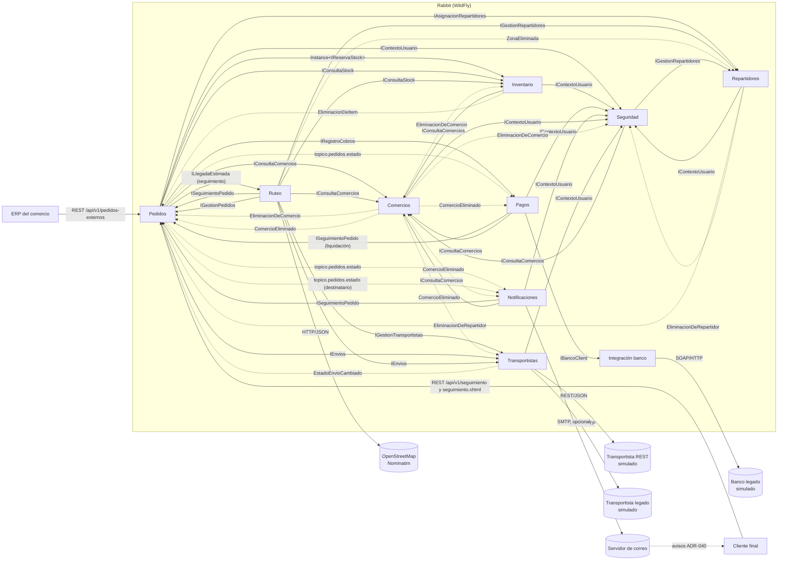
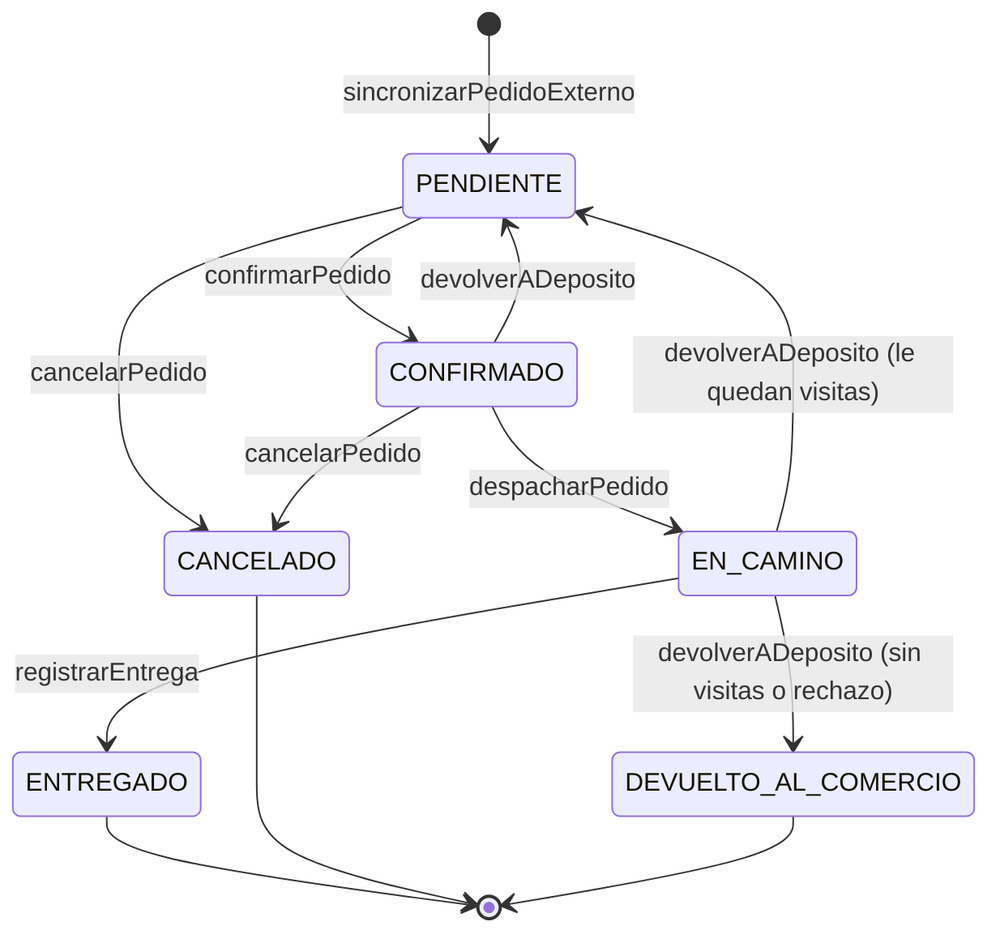

# Arquitectura

## Capas

Cada componente se organiza en tres capas con dependencia en un solo
sentido: **Presentación → Negocio → Datos**.

| Capa | Tecnología | Responsabilidad | Paquete |
|---|---|---|---|
| Presentación | JSF (`@Named` + `@ViewScoped`), Facelets | Mostrar y capturar datos. Sin reglas de negocio. | `presentacion/` |
| Negocio | EJB (`@Stateless`, `@Stateful`, `@Singleton`, `@MessageDriven`) | Reglas del dominio, transacciones, seguridad, orquestación entre componentes | `negocio/` |
| Datos | JPA / Hibernate | Persistencia. Única capa que toca el `EntityManager` | `datos/`, `datos/model/` |
| (transversal) | POJOs | Objetos que cruzan capas y componentes | `dto/` |

**Por qué así:** la vista nunca ve entidades JPA (evita
`LazyInitializationException` y acopla la vista al esquema), y las reglas
viven en un solo lugar (el EJB), sin importar si las invoca una pantalla,
un timer o un MDB.

## Componentes

Rabbit tiene **9 componentes de negocio**. La fila "Integración banco
legado" es la capa técnica `integracion` (cliente SOAP del banco y
adaptadores de transportistas): tiene una interfaz `@Local`
(`IBancoClient`) pero no es un componente de negocio.

Cada componente expone interfaces `@Local` separadas por uso (lectura vs.
escritura) y nunca expone sus entidades ni sus excepciones internas a
otro componente. Las referencias entre componentes se guardan como IDs
(`Long idComercio`), no como relaciones JPA.

| Componente | Estado | Interfaces | Tipo de EJB | Por qué ese tipo |
|---|---|---|---|---|
| Comercios | Implementado | `IRegistroComercios`, `IConsultaComercios` | `@Stateless` | Cada operación recibe todo lo que necesita; el estado vive en la base |
| Inventario | Implementado | `IConsultaStock`, `IReservaStock` | `@Stateful` (`InventarioService`, `IReservaStock`) + `@Stateless` (`ConsultaStockService`, `IConsultaStock`) | La reserva es una conversación: `reservarStock` y `confirmarReserva` operan sobre la misma instancia |
| Pedidos | Implementado | `IGestionPedidos`, `ISeguimientoPedido`, `IIndicadores` (ADR-044) | `@Stateless` (Facade) | El estado del pedido vive en la base; ninguna operación depende de una llamada anterior |
| Seguridad | Implementado | `IRegistroUsuarios`, `IConsultaUsuarios`, `IContextoUsuario` | `@Stateless` | Idem Comercios |
| Integración banco legado (capa técnica, no componente de negocio) | Implementado | `IBancoClient` | `@Stateless` + `@Singleton` (`CircuitBreakerBanco`) | Cliente SOAP sin estado de conversación; el estado del circuit breaker es uno solo, compartido por todas las llamadas |
| Pagos y Cobranzas | Implementado | `IRegistroCobros`, `IConsultaCobros`, `ILiquidaciones` (ADR-034) | `@Stateless` + `@MessageDriven` (suscriptor) + `@Singleton` (`LiquidacionMensual`, timer) | El cobro queda registrado en la base; se suma a la transacción del llamador |
| Repartidores | Implementado | `IAsignacionRepartidores`, `IGestionRepartidores` | `@Stateless` | La disponibilidad del repartidor es un dato persistido, no de sesión |
| Notificaciones | Implementado | `INotificaciones`, `IAvisosAlDestinatario` (ADR-040) | `@Stateless` + `@MessageDriven` (dos de los tres suscriptores del tópico: comercio y destinatario; el tercero es Pagos) | Reacciona a eventos del tópico; nadie la llama para avisar |
| Ruteo | Implementado | `IRuteo`, `IZonas`, `ILlegadaEstimada` (ADR-043) | `@Stateless` (`LlegadaEstimadaService` con `@RunAs`) | Arma cada hoja de ruta de cero con lo que está en la base; las zonas son datos persistidos y el despacho no depende de una llamada anterior |
| Transportistas | Implementado | `IGestionTransportistas`, `IEnvios`, `ISeguimientoEnvios` | `@Stateless` + `@Singleton` (`SeguimientoDeEnvios`, timer) | El estado de cada envío vive en la base; el seguimiento es una sola tarea periódica |

### Operaciones por componente (implementado)

| Componente | Interfaz | Operaciones | Quién la usa |
|---|---|---|---|
| Comercios | `IRegistroComercios` | `registrarComercio`, `actualizarDatosFiscales`, `darDeBajaComercio`, `reactivarComercio`, `eliminarComercio`, `registrarPuntoPicking`, `darDeBajaPuntoPicking`, `reactivarPuntoPicking` | `ComercioBean`, `PuntoPickingBean` |
| Comercios | `IConsultaComercios` | `obtenerComercio`, `listarTodos`, `listarPuntosPicking`, `listarPuntosPickingDeComercio`, `validarComercioActivo` | Vistas, Inventario, Pedidos, Ruteo, Seguridad (`UsuarioService`, `SesionBean`) |
| Inventario | `IConsultaStock` | `registrarDeposito`, `listarDepositos`, `obtenerDeposito`, `listarDepositosConStock`, `registrarItem`, `actualizarItem`, `eliminarItem` (solo administrador, ADR-049), `listarItemsPorDeposito`, `listarItemsPorComercio`, `listarItemsPorComercioYDeposito`, `listarItemsPorIds`, `pesosPorItem` (sin rol, ADR-032), `listarStockDelComercioActual`, `consultarDisponibilidad`, `listarHistorialReservas` | `DepositoBean`, `ItemInventarioBean`, `HistorialReservasBean`, `PedidoBean`, `PortalComercioBean`, Pedidos, Ruteo |
| Inventario | `IReservaStock` | `reservarStock`, `confirmarReserva`, `liberarReserva`, `extenderReserva`, `obtenerReservaActual`, `hayReservaVigente`, `registrarDevolucion` | `ReservaBean`, Pedidos |
| Pedidos | `IGestionPedidos` | `registrarPedidoExterno`, `cancelarPedidoExterno`, `sincronizarPedidoExterno`, `descartarPedidoExterno`, `confirmarPedido`, `confirmarPedidoEnZona` (null = quedó en lista de espera), `asignarDesdeEspera`, `sacarDeEspera`, `devolverADeposito` (motivo fijo e intentos: ADR-037 y 041), `listarIntentosDeEntrega` y `obtenerFotoDeVisita` (evidencia de cada visita, ADR-045), `derivarATransportista`, `cotizarDerivacion`, `despacharPedido`, `registrarEntrega` (con remito: ADR-033), `registrarEntregaDeTransportista`, `obtenerRemito`, `cancelarPedido` | `PedidoBean`, `MisEntregasBean`, `RemitoServlet`, Ruteo, MDB, timer |
| Pedidos | `ISeguimientoPedido` | `listarPedidosExternos`, `consultarPedidoExterno`, `consultarEstadoPedido`, `consultarSeguimiento`, `listarPendientes`, `listarTodos`, `listarPedidosDeComercio`, `listarEntregasEnCurso`, `listarPedidosDelComercioActual`, `listarPedidosDelRepartidorActual`, `listarEntregasEnCursoDeRepartidor` (ADR-043), `resumenEntregas`, `resumenEntregasDelComercioActual` (ADR-034) | `PedidoBean`, `PortalComercioBean`, Ruteo, Pagos, Notificaciones, API REST |
| Pedidos | `IIndicadores` | `calcular` (personal: toda la red o un comercio), `calcularDelComercioActual` (ADR-044) | `IndicadoresBean` |
| Notificaciones | `IAvisosAlDestinatario` | `avisar`, `listarRecientes` (ADR-040) | `SuscriptorDestinatarioEstadoPedido`, `CampanaBean` |
| Seguridad | `IRegistroUsuarios` | `registrarUsuario`, `darDeBaja`, `reactivarUsuario`, `restablecerClave` (ADR-031), `eliminarUsuario` (ADR-036) | `UsuarioBean` |
| Seguridad | `IConsultaUsuarios` | `listarTodos`, `obtenerUsuario` | `UsuarioBean` |
| Seguridad | `IContextoUsuario` | `idComercioActual`, `idRepartidorActual` | Pedidos, Inventario, Comercios, Notificaciones, `SesionBean` |
| Transportistas | `IGestionTransportistas` | `registrarTransportista`, `darDeBajaTransportista`, `reactivarTransportista`, `listarTodos`, `listarActivos` | `TransportistaBean`, `PedidoBean`, `SeguimientoDeEnvios` |
| Transportistas | `IEnvios` | `solicitarEnvio`, `cotizarEnvio`, `cancelarEnvioDePedido`, `listarEnvios`, `listarEnviosDelComercioActual` | Pedidos, Ruteo, `PedidoBean`, `TransportistaBean`, `PortalComercioBean` |
| Transportistas | `ISeguimientoEnvios` | `listarEnviosActivos`, `registrarNovedad` | `SeguimientoDeEnvios` (interna del componente) |
| Ruteo | `IRuteo` | `listarEntregasEnCurso`, `entregasEnCursoDelRepartidor`, `recorridoRecomendado` (ADR-038), `recorridoDeRepartidor` (ADR-043), `historialDelRepartidor`, `listarPendientesPorZona`, `despacharPedido`, `despacharZona` | `EntregasBean`, `MisEntregasBean`, `RuteoBean`, `LlegadaEstimadaService` |
| Ruteo | `ILlegadaEstimada` | `estimar` (parada y franja de un pedido en camino, ADR-043) | `SeguimientoBean`, `SeguimientoResource` |
| Ruteo | `IZonas` | `registrarZona`, `darDeBajaZona`, `reactivarZona`, `eliminarZona` (ADR-036), `listarTodas`, `zonaDeCodigoPostal` | `RuteoBean`, `RepartidorBean`, `RuteoService` |
| Pagos | `IRegistroCobros` | `registrarCobro`, `registrarCobroContraEntrega`, `anularCobro` (`ADMINISTRADOR`), `anularCobroPorDevolucion` (sin rol, ADR-041) | Pedidos, `SuscriptorPagosEstadoPedido` |
| Pagos | `IConsultaCobros` | `obtenerCobroDePedido`, `listarTodos`, `listarCobrosDelComercioActual` | `PedidoBean`, `PortalComercioBean` |
| Repartidores | `IAsignacionRepartidores` | `asignarRepartidor` (zona preferida, peso, bultos y repartidor excluido: ADR-032 y 037), `motivoParaEsperar`, `antesDelCorte`, `diaDeEntregaPara` (fecha prometida, ADR-042), `liberarRepartidor`, `ultimaUbicacion` (ubicación de la visita fallida, ADR-045) | Pedidos |
| Repartidores | `IGestionRepartidores` | `registrarRepartidor`, `asignarZona`, `actualizarCapacidad`, `eliminarRepartidor` (ADR-036), `listarTodos`, `obtenerRepartidor`, `registrarUbicacion`, `listarUbicacionesRecientes`, `ubicacionParaPedido` (ADR-035) | `RepartidorBean`, `MapaBean`, `MisEntregasBean`, `SeguimientoBean`, `PedidoBean`, Ruteo, Seguridad |
| Pagos | `ILiquidaciones` | `liquidarMes`, `previsualizar`, `reintentarCobro`, `reintentarPendientes`, `listarDelPeriodo`, `listarPeriodos`, `listarDelComercioActual`, `previsualizarMesEnCursoDelComercioActual`, `tarifaVigente` (ADR-034) | `LiquidacionBean`, `MisLiquidacionesBean`, `LiquidacionMensual` (timer) |
| Notificaciones | `INotificaciones` | `avisarCambioDeEstado`, `listarRecientes`, `listarDelComercioActual` | `SuscriptorNotificacionesEstadoPedido`, `CampanaBean` |

Otros detalles de cada componente:

- **Inventario:** `IReservaStock` (`InventarioService`, `@Stateful`)
  mantiene la reserva abierta entre requests con `@StatefulTimeout`;
  `BarredorDeReservas` (`@Schedule`) libera las reservas vencidas que el
  usuario no resolvió. Las consultas y la carga de stock (`IConsultaStock`)
  están en `ConsultaStockService` (`@Stateless`): no tienen conversación, y
  así quien solo consulta no queda atado a una instancia stateful que
  puede vencer (ADR-027).
- **Comercios:** eliminar un comercio es físico y solo se permite si ya
  está dado de baja y si nada vivo lo referencia (pedidos en curso o
  entregados, pedidos del ERP sin sincronizar, stock consignado, cuentas
  de usuario): cada componente lo verifica al recibir el evento
  `EliminacionDeComercio`. Si hay referencias, el comercio queda dado de
  baja. Los pedidos cancelados no impiden: con la eliminación decidida,
  `ComercioEliminado` hace que Pedidos, Pagos, Notificaciones y
  Transportistas borren ese historial en la misma transacción (ADR-028).
- **Repartidores, zonas y usuarios:** el administrador también los puede
  eliminar (ADR-036), con el mismo esquema de eventos: Pedidos y
  Seguridad impiden eliminar un repartidor con entregas en curso o con
  cuenta (`EliminacionDeRepartidor`) y después le sueltan la referencia
  (`RepartidorEliminado`); al eliminar una zona, Repartidores deja sin
  zona fija a los suyos (`ZonaEliminada`).
- **Pedidos:** un pedido es multi-línea (`LineaPedido`). Con origen
  `STOCK_CONSIGNADO` cada línea reserva y confirma stock en su propia
  instancia de `IReservaStock`; con `PUNTO_PICKING` solo se valida que el
  punto de picking esté activo. Al cancelar, solo se devuelve el stock de
  las líneas con `idReservaStock`.
- **Seguridad:** `LoginBean` y `SesionBean` toman el usuario y sus roles
  del `SecurityContext` de WildFly. `SesionBean` además usa
  `IContextoUsuario` para saber a qué comercio o repartidor representa la
  cuenta (lo muestra en el menú). `IContextoUsuario` es la pieza que usan
  los demás componentes para filtrar por dueño.
- **Pagos:** PREPAGO se cobra por SOAP en el banco legado al confirmar
  (rechaza por encima de $500.000); si la confirmación falla después, se
  pide la reversa al banco;
  CONTRA_ENTREGA queda PENDIENTE y se acredita al recibir `ENTREGADO` por
  el tópico.
- **Repartidores:** `asignarRepartidor` le da el pedido al primero al que
  le entra (`AsignacionPorCapacidad`; los de la zona primero), con bloqueo
  pesimista para que dos confirmaciones simultáneas no carguen de más al
  mismo repartidor. Se libera al entregar, cancelar o devolver el pedido.
- **Lista de espera (ADR-037):** si no le entra a nadie o ya pasó la hora
  de corte (`HoraDeCorte`: 07:00 por defecto, `rabbit.ruteo.hora-corte` la cambia), el
  pedido queda PENDIENTE con `enEsperaDesde`, sin cobrar.
  `AsignadorDeEspera` (`@Singleton`, `@RunAs("OPERADOR")`) recorre la
  fila cada minuto y apenas un pedido se entrega, cancela o devuelve
  (`AvisosDeEspera`, después del commit).
- **Hoja de ruta recomendada (ADR-038):** `OrdenDeRecorrido` ordena las
  paradas del repartidor (retiros primero, entregas por cercanía de CP) y
  `EnlaceMapa.tramos` arma los links de Google Maps de hasta 10 puntos.
- **Notificaciones:** el aviso queda guardado y se ve en la campana de la
  cabecera (`CampanaBean`, ADR-051): el comercio, los de sus pedidos; el
  personal, los avisos a comercios y a quien recibe; si hay un servidor de
  correo configurado,
  además se le manda por mail (`AvisosPorMail`, después del commit).
  Descarta eventos más viejos que el último avisado del mismo pedido.
- **Transportistas:** un pedido pendiente se puede **derivar** a una
  empresa de envíos externa en lugar de confirmarlo con un repartidor
  propio (`derivarATransportista`). Cada transportista se integra con su
  propia tecnología a través de un Adapter (`IAdaptadorTransportista`:
  REST o SOAP legado) y `SeguimientoDeEnvios` consulta cada 15 s el estado
  de los envíos activos; Pedidos mueve el pedido al recibir el evento
  `EstadoEnvioCambiado`. Detalle en
  [MENSAJERIA-SINCRONICA.md](../integraciones/MENSAJERIA-SINCRONICA.md) y ADR-016.
- **Ruteo:** arma la hoja de ruta de cada pedido: de dónde se retira (el
  punto de picking, o cada depósito del que sale stock consignado), adónde
  se entrega (`direccionEntrega`, que manda el ERP) y cuánto cobrar si es
  contra entrega. Además agrupa los pedidos pendientes por **zona**
  (rangos de código postal, tabla `zonas`) y los despacha según la
  cobertura de la zona: con un repartidor propio de la zona, derivados a
  su transportista, o al transportista de respaldo si no hay repartidores
  libres. Cada pedido se despacha en su propia transacción. Los pedidos
  sin código postal quedan "sin zona" para el despacho manual. En el
  tablero del personal, cada hoja de ruta tiene un link "Ver recorrido en
  el mapa" (Google Maps, sin clave; lo arma `EnlaceMapa`). El repartidor
  ve una hoja de ruta recomendada con todas sus paradas, ordenadas por
  cercanía de código postal y no por distancia real (no hay
  geocodificación), con el recorrido en Google Maps en tramos de hasta 10
  puntos. Ver ADR-017 y ADR-038.

### Dependencias entre componentes (implementadas)

Las flechas punteadas son eventos, no llamadas: el tópico JMS entre
Pedidos y sus suscriptores, el evento CDI `EstadoEnvioCambiado` (Transportistas avisa
sin depender de Pedidos) y el evento CDI `EliminacionDeComercio`, con el
que Comercios pregunta si algo todavía referencia al comercio sin depender
de los componentes que ya dependen de él, seguido de `ComercioEliminado`,
con el que cada uno borra el historial terminado de ese comercio.

## Vistas por tipo de usuario

Cada tipo de usuario entra a su propia pantalla y ve su propio menú
(`SesionBean.getPaginaInicio` y `WEB-INF/plantillas/template.xhtml`). Las
páginas están en una carpeta por tipo de usuario (`personal/`,
`comercio/`, `repartidor/`). Cada página tiene su
guardián (`<f:viewAction>`) y cada EJB su `@RolesAllowed`; el comercio o
el repartidor sale siempre de la identidad autenticada
(`IContextoUsuario`), nunca de un parámetro. Ver
[SEGURIDAD.md](../seguridad/SEGURIDAD.md).

| Tipo | Pantallas |
|---|---|
| Personal de Rabbit (`ADMINISTRADOR`, `OPERADOR`) | Pedidos (incluye derivar a un transportista), la campana de notificaciones (avisos a comercios y a destinatarios), Ruteo por zona (despacho y zonas), Entregas en curso (tablero del Ruteo), Indicadores (ADR-044), Repartidores, Transportistas, Comercios y sus puntos de picking, Depósitos y stock, Reserva de stock, Historial de reservas. Usuarios, solo `ADMINISTRADOR` |
| `COMERCIO` | Mis pedidos (estado, cobro, repartidor, fecha prometida, visitas fallidas y avisos de Rabbit), Mis indicadores (ADR-044), Mi stock (consignado en los depósitos), Mis puntos de picking |
| `REPARTIDOR` | Mis entregas: la hoja de ruta recomendada con todas sus paradas (ADR-038), sus entregas en curso con quién recibe y su teléfono (ADR-039), "Ya retiré el pedido", "Entregar pedido" (ventana para la foto del remito) y "Devolver a depósito" con motivo fijo (ADR-037 y 041), y su historial. Pensada para el celular |
| `ERP` | Ninguna: solo usa la API REST. Si intenta entrar a la web, el login lo rechaza |

## Mapa de integración

| Tramo | Mecanismo | Estado | Detalle |
|---|---|---|---|
| ERP del comercio → Rabbit | Formulario JSF (simulación) | Implementado | Queda para la demo |
| ERP del comercio → Rabbit | REST `/api/v1/pedidos-externos` (alta, consulta y cancelación; contrato en [openapi.yaml](../integraciones/openapi.yaml)) | Implementado | [MENSAJERIA-SINCRONICA.md](../integraciones/MENSAJERIA-SINCRONICA.md) |
| Cliente final → Rabbit | REST `GET /api/v1/seguimiento/{codigo}` (público; con fecha prometida y, en camino, parada y franja: ADR-042 y 043) | Implementado | [MENSAJERIA-SINCRONICA.md](../integraciones/MENSAJERIA-SINCRONICA.md) |
| Alta de pedido externo → sincronización | Cola JMS `cola.pedidos.externos` | Implementado | [MENSAJERIA-ASINCRONICA.md](../integraciones/MENSAJERIA-ASINCRONICA.md) |
| Pagos → Banco legado | SOAP | Implementado | [MENSAJERIA-SINCRONICA.md](../integraciones/MENSAJERIA-SINCRONICA.md) |
| Cambio de estado del pedido → Notificaciones (comercio y destinatario), Pagos | Tópico JMS `topico.pedidos.estado`, tres suscripciones durables | Implementado | [MENSAJERIA-ASINCRONICA.md](../integraciones/MENSAJERIA-ASINCRONICA.md) |
| Transportistas → transportista moderno | REST/JSON saliente (cliente JAX-RS) | Implementado | [MENSAJERIA-SINCRONICA.md](../integraciones/MENSAJERIA-SINCRONICA.md) |
| Transportistas → transportista legado | SOAP saliente | Implementado | [MENSAJERIA-SINCRONICA.md](../integraciones/MENSAJERIA-SINCRONICA.md) |
| Notificaciones → comercio y quien recibe (ADR-040) | SMTP (Jakarta Mail), después del commit | Implementado (si se configura el servidor) | [MENSAJERIA-ASINCRONICA.md](../integraciones/MENSAJERIA-ASINCRONICA.md) |
| Ruteo → OpenStreetMap (ADR-046) | REST/HTTP saliente (Nominatim), desde un timer y con caché | Implementado | [DECISIONES.md](DECISIONES.md#adr-046-hoja-de-ruta-por-distancia-con-openstreetmap) |
| Pedidos → Comercios, Inventario, Pagos, Repartidores, Transportistas | Llamada local EJB | Implementado | No es integración entre sistemas: mismo proceso |

### Criterio sincrónico vs. asincrónico

| | Asincrónico (JMS) | Sincrónico (SOAP / REST) |
|---|---|---|
| Caso en Rabbit | Sincronizar pedido externo; avisar cambios de estado | Cobrar en el banco; recibir un pedido del ERP |
| ¿El proceso puede seguir sin la respuesta? | Sí | No |
| Si el otro lado no contesta | El mensaje espera o se reintenta (y hay polling de respaldo) | Hay que decidirlo explícitamente (timeout + degradación; circuit breaker con el banco) |
| Acoplamiento | Solo al formato del mensaje | Temporal + contrato |

## Máquina de estados del pedido

Implementada en `EstadoPedido.puedePasarA(...)`. Todo cambio de estado de
un pedido existente pasa por `PedidoService.cambiarEstado(...)`, que
valida la transición y dispara el evento `EstadoPedidoCambiado`.

- **Un pedido que salió a reparto no se cancela (ADR-048):** ni EN_CAMINO
  ni después, si volvió al depósito para otra visita (`salioAReparto`,
  `ReglaDeCancelacion`). Solo queda entregarlo; si no se puede, el
  repartidor lo **devuelve al depósito** (entrega fallida): vuelve a
  PENDIENTE en la lista de espera para otra visita (ADR-037) o, sin
  visitas, termina DEVUELTO_AL_COMERCIO.
- **Las visitas tienen límite (ADR-041):** cada devolución desde
  EN_CAMINO con un motivo que implica haber ido a la dirección cuenta como
  visita. Con 2 (`rabbit.entregas.max-intentos`) o si el cliente lo
  rechazó, el pedido pasa a DEVUELTO_AL_COMERCIO, que es final: el stock
  consignado vuelve al comercio y Pagos anula el cobro al recibir el
  evento por el tópico.
- **Lista de espera no es un estado:** es un PENDIENTE con
  `enEsperaDesde`, así la máquina de estados y los suscriptores del
  tópico no cambian.
- **Por qué centralizar las transiciones:** la regla está en un solo
  lugar, y protege contra acciones fuera de orden (un "entregar" sobre un
  pedido cancelado, o eventos que llegan desordenados).

## Datos del pedido que vienen del ERP

`importe`, `medioPago` (`PREPAGO` / `CONTRA_ENTREGA`) y
`direccionEntrega` llegan en el pedido externo y pasan tal cual al
`Pedido` al sincronizar. También el email de quien recibe (obligatorio
desde el 18/10) y, opcionales, su nombre y su teléfono (ADR-039). La fecha prometida la calcula Rabbit al
recibirlo, con la hora de corte (ADR-042). La dirección es obligatoria: es el destino de la
hoja de ruta. Rabbit no
calcula precios: ver ADR-004 en [DECISIONES.md](DECISIONES.md).
