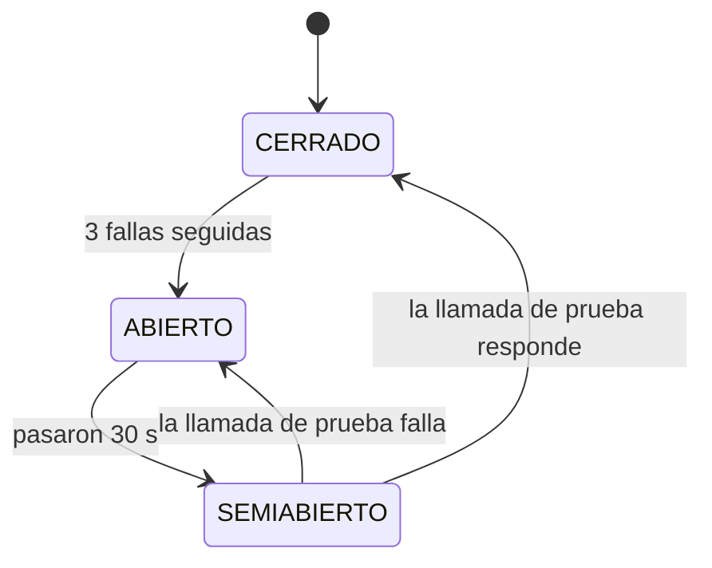
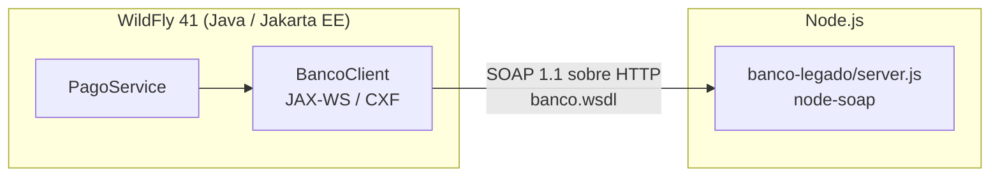

# Desafíos opcionales

Qué desafíos opcionales de la consigna encara Rabbit, cómo se cumplen y
cómo se muestran en la defensa.

- [Resiliencia ante fallas](#1-resiliencia-ante-fallas): Cumple
- [Escalabilidad horizontal bajo carga simulada](#2-escalabilidad-horizontal-bajo-carga-simulada): Cumple: con 8 consumidores, 100 pedidos se procesan 6,3 veces más rápido que con uno (medido)
- [Architecture Decision Records](#3-architecture-decision-records): Cumple: 72 ADR en [DECISIONES.md](../arquitectura/DECISIONES.md); acá se desarrollan 3 con sus alternativas
- [Heterogeneidad tecnológica](#4-heterogeneidad-tecnológica): Cumple: el banco legado también está implementado en Node.js y Rabbit (Java) lo consume por SOAP sin cambiar código; el transportista moderno, en Python, por REST

## 1. Resiliencia ante fallas

**Qué se pide:** que una falla en una parte del sistema no tire abajo al
resto, y que el sistema se recupere solo cuando la falla termina.

### Fallas contempladas

- **El banco legado no responde**
  - Qué pasa en Rabbit: El pedido prepago no se confirma y sigue PENDIENTE; el resto de la plataforma sigue funcionando
  - Mecanismo: Timeout de 5 s en el cliente SOAP
- **El banco sigue caído**
  - Qué pasa en Rabbit: Después de 3 fallas seguidas, los pedidos prepago fallan al instante, sin esperar el timeout; a los 30 s se prueba una llamada y, si el banco volvió, todo sigue normal
  - Mecanismo: Circuit breaker (ADR-011)
- **El banco cobró pero Rabbit falla después (por ejemplo, no hay repartidor)**
  - Qué pasa en Rabbit: Rabbit deshace su parte y le pide al banco que devuelva la plata
  - Mecanismo: Transacción compensatoria (ADR-010)
- **Se pierde el mensaje de un pedido del ERP (broker caído, mensaje sin enviar)**
  - Qué pasa en Rabbit: El pedido se sincroniza igual en menos de un minuto
  - Mecanismo: Polling de respaldo sobre la cola (ADR-001)
- **Un suscriptor del tópico está caído (por ejemplo, en un redeploy)**
  - Qué pasa en Rabbit: Recibe los cambios de estado cuando vuelve; no se pierde ningún cobro contra entrega
  - Mecanismo: Suscripciones durables (ADR-009)
- **Un transportista no responde al derivarle un pedido**
  - Qué pasa en Rabbit: El pedido no se deriva y sigue PENDIENTE (si ya se había cobrado, se revierte); el personal puede probar con otro
  - Mecanismo: Timeout de 5 s en el adaptador REST y rollback de la derivación (ADR-016)
- **El transportista aceptó el envío pero Rabbit falla después**
  - Qué pasa en Rabbit: Rabbit deshace su parte y le pide al transportista que cancele el envío
  - Mecanismo: Transacción compensatoria (`CancelacionesDeEnvios`, ADR-016)
- **El seguimiento de un envío falla (transportista caído o novedad que no se puede aplicar)**
  - Qué pasa en Rabbit: Ese envío se reintenta en la próxima pasada, 15 s después; los demás siguen
  - Mecanismo: Una transacción por novedad (`REQUIRES_NEW`)
- **Un mensaje llega dos veces**
  - Qué pasa en Rabbit: Se procesa una sola vez
  - Mecanismo: Sincronización y cobro contra entrega idempotentes
- **El broker falla al publicar un cambio de estado**
  - Qué pasa en Rabbit: El aviso no se pierde: sale apenas el broker vuelve, y con él el cobro contra entrega y la notificación
  - Mecanismo: Bandeja de salida (`eventos_estado_pedido`, guardada en la misma transacción que el cambio de estado) y reenvío cada 15 s
- **El servidor de correo no responde**
  - Qué pasa en Rabbit: El aviso queda en el portal y el mail sale cuando el servidor vuelve (hasta 24 horas después)
  - Mecanismo: Bandeja de correos (`BandejaDeCorreos`) y reintento cada minuto (`EnvioDeCorreosPendientes`)

### El circuit breaker, en detalle

Sin él, con el banco colgado, cada confirmación de un pedido prepago
bloquea un hilo del servidor durante los 5 s del timeout. Con muchos
usuarios a la vez, esos hilos se agotan y la caída del banco termina
afectando pantallas que no tienen nada que ver con cobrar (falla en
cascada).



Implementación: `CircuitBreakerBanco` (`@Singleton`), consultado por
`BancoClient` antes de cada llamada. Detalle en
[MENSAJERIA-SINCRONICA.md](../integraciones/MENSAJERIA-SINCRONICA.md#circuit-breaker).

### Resultado medido

Con el banco simulado colgado y 4 pedidos prepago confirmados seguidos,
en la app desplegada:

- **1**
  - Tiempo hasta la respuesta: 5,2 s (timeout)
  - Estado del circuito: CERRADO, 1 falla
- **2**
  - Tiempo hasta la respuesta: 5,2 s (timeout)
  - Estado del circuito: CERRADO, 2 fallas
- **3**
  - Tiempo hasta la respuesta: 5,2 s (timeout)
  - Estado del circuito: Se abre
- **4**
  - Tiempo hasta la respuesta: **0,2 s** (no se llama al banco)
  - Estado del circuito: ABIERTO

Con el banco repuesto, pasados 30 s, la siguiente confirmación prueba al
banco, cobra en 1,9 s y el circuito se cierra solo.

### Cómo mostrarlo en la defensa

```bash
# 1. Colgar el banco simulado (tarda 10 s y no procesa nada)
$WILDFLY_HOME/bin/jboss-cli.sh --connect --command="/system-property=rabbit.banco.simular.caida:add(value=true)"
# 2. Confirmar 4 pedidos prepago desde Pedidos: los 3 primeros tardan 5 s, el 4.º falla al instante
# 3. Reponer el banco
$WILDFLY_HOME/bin/jboss-cli.sh --connect --command="/system-property=rabbit.banco.simular.caida:remove"
# 4. Esperar 30 s y confirmar otro: cobra y el circuito se cierra
```

En el log se ven las transiciones con el prefijo `[Pagos][Circuito]`.

### Limitaciones

- Si el banco cobra pero la respuesta se pierde por el timeout, ese cobro
  queda sin registrar en Rabbit (lo resolvería una clave de idempotencia).
- Si el banco no responde a una reversa, queda logueada para hacerla a
  mano.
- El estado del circuito vive en cada servidor: en un cluster, cada nodo
  descubre la caída por su cuenta.

## 2. Escalabilidad horizontal bajo carga simulada

**Qué se pide:** escalar horizontalmente un componente bajo carga
simulada y mostrar la mejora medida.

### Componente elegido: el consumidor de la cola de pedidos del ERP

Cada pedido que manda el ERP de un comercio entra por
`cola.pedidos.externos` y lo convierte en pedido real
`PedidoExternoListener`. Es el punto de entrada de toda la operación: si
un comercio grande manda muchos pedidos juntos (por ejemplo, al cierre de
un día de ventas), la cola se llena y los pedidos tardan en aparecer.

Se escala con el patrón **consumidores competidores**: varias instancias
del consumidor leen la misma cola y el broker le da cada mensaje a una
sola. No hace falta cambiar código ni coordinar las instancias, y el
procesamiento ya era seguro en paralelo: `sincronizarPedidoExterno`
bloquea la fila con `PESSIMISTIC_WRITE` y es idempotente (ADR-001).

La cantidad de instancias se fija con la system property
`rabbit.cola.consumidores` (en `WEB-INF/jboss-ejb3.xml`, que la aplica
como `maxSession` del MDB; 15 por defecto). Se lee al desplegar:

```bash
$WILDFLY_HOME/bin/jboss-cli.sh --connect --command="/system-property=rabbit.cola.consumidores:add(value=4)"
$WILDFLY_HOME/bin/jboss-cli.sh --connect --command="/deployment=Rabbit.war:redeploy"
```

Dentro de un servidor, cada consumidor es una sesión JMS con su propio
hilo. Entre servidores funciona igual: un segundo WildFly conectado al
mismo broker suma consumidores a la misma cola (ver Limitaciones).

### Cómo se mide

El script [`scripts/prueba_escalabilidad.py`](../../scripts/prueba_escalabilidad.py)
hace, para cada cantidad de consumidores:

1. Fija `rabbit.cola.consumidores` y redespliega.
2. Pausa el timer de respaldo (`rabbit.sincronizador.pausado=true`), para
   que no procese pedidos de la carga y falsee la medición.
3. Manda 10 pedidos de calentamiento, que no se miden.
4. Pausa la cola, manda los 100 pedidos de la carga por la API del ERP
   (`POST /api/v1/pedidos-externos`, cada uno con su `Idempotency-Key`) y
   la reanuda. Así se mide solo el procesamiento, no el envío.
5. Toma del log del servidor la hora en que se sincronizó cada pedido y
   qué hilo lo procesó.

Métricas: tiempo total hasta procesar los 100, pedidos por segundo,
espera media y percentil 95 desde que se reanuda la cola, y cantidad de
hilos que efectivamente procesaron (para confirmar el paralelismo).

### Resultados

Medido el 29/09/2026: 100 pedidos por corrida, más 10 de calentamiento que
no se cuentan. Rabbit corría en WildFly 41 local (10 núcleos) contra la base
de Supabase (región sa-east-1, Session Pooler), con el pool de conexiones
en 10. Ninguna corrida tuvo errores ni pedidos descartados.

- **1**
  - Tiempo total: 43,2 s
  - Pedidos/s: 2,3
  - Espera media: 22,2 s
  - Espera p95: 41,1 s
  - Hilos que procesaron: 1
  - Mejora: base
- **4**
  - Tiempo total: 11,3 s
  - Pedidos/s: 8,9
  - Espera media: 6,1 s
  - Espera p95: 10,8 s
  - Hilos que procesaron: 4
  - Mejora: **x3,8**
- **8**
  - Tiempo total: 6,8 s
  - Pedidos/s: 14,6
  - Espera media: 3,8 s
  - Espera p95: 6,4 s
  - Hilos que procesaron: 8
  - Mejora: **x6,3**

Qué mide cada columna:

- **Tiempo total:** desde que se reanuda la cola hasta que se sincroniza
  el último pedido.
- **Espera:** cuánto tarda cada pedido en quedar sincronizado desde que se
  reanuda la cola; p95 es la espera que no superó el 95 % de los pedidos.
- **Hilos que procesaron:** confirma que el paralelismo fue real (tantos
  hilos como consumidores).

**Lectura.** Con un consumidor, cada pedido tarda unos 0,43 s, casi todo
en viajes de ida y vuelta a la base (validar comercio y punto de picking,
guardar el pedido, marcar la fila). Ese tiempo es espera de red, no uso de
CPU, así que varios consumidores en paralelo lo aprovechan casi por
completo: con 4 la mejora es casi lineal (x3,8 de x4 posible, 95 %). Con 8
la mejora sigue (x6,3, 79 %) pero rinde menos por consumidor, porque 8 de
las 10 conexiones del pool están ocupadas y los consumidores empiezan a
competir por la base. Para el comercio que manda 100 pedidos juntos, el
último pasa de esperar 43 s a esperar menos de 7 s.

Para correrla de nuevo (el script imprime esta misma tabla al terminar):

```bash
export WILDFLY_HOME=... RABBIT_ERP_USUARIO=... RABBIT_ERP_CLAVE=...   # ERP creado desde la app
export RABBIT_ID_PUNTO=...   # punto de picking activo del comercio de ese ERP
# RABBIT_BASE (opcional): por defecto https://localhost:8443/Rabbit/ (acepta el certificado local autofirmado)
python3 scripts/prueba_escalabilidad.py 1 4 8 --pedidos 100
```

### Hallazgo: el techo lo pone la base de datos

Al preparar la prueba, la primera carga falló con
`EMAXCONNSESSION: max clients reached in session mode - max clients are
limited to pool_size: 15`. El pooler de Supabase en modo sesión admite
como máximo **15 conexiones para todo el proyecto**, y el pool de WildFly
permitía hasta 20.

Consecuencias:

- **Sumar consumidores no escala sin límite:** cada consumidor usa una
  conexión mientras procesa. Con el pool en 10 (valor usado para la
  prueba), más de 10 consumidores solo esperan conexión; ya con 8 se nota
  en la eficiencia (79 %, ver Resultados).
- **El cupo se comparte:** varios integrantes con la app levantada contra
  la misma base compiten por esas 15 conexiones.
- **Configuración recomendada:** `max-pool-size` del datasource `RabbitDS`
  en 10 o menos:

  ```bash
  $WILDFLY_HOME/bin/jboss-cli.sh --connect --command="/subsystem=datasources/data-source=RabbitDS:write-attribute(name=max-pool-size,value=10)"
  $WILDFLY_HOME/bin/jboss-cli.sh --connect --command=":reload"
  ```

Para escalar más allá haría falta el Transaction Pooler de Supabase
(incompatible con el arranque de Hibernate, ver README) o una base con
más conexiones.

### Limitaciones

- La prueba escala instancias dentro de un servidor. En varios servidores
  el mecanismo es el mismo, pero no se probó: el broker embebido es de
  cada WildFly y habría que compartir uno.
- En un cluster, el estado del circuit breaker es de cada servidor. Los
  usuarios no: están en la base compartida (ADR-031).
- La latencia hasta Supabase domina el tiempo de cada pedido: los números
  dependen de la red desde donde se corra.

## 3. Architecture Decision Records

Los 72 ADR del proyecto están en [DECISIONES.md](../arquitectura/DECISIONES.md). Estos
tres son los de más peso en la arquitectura; acá se desarrollan con las
alternativas consideradas y por qué se descartaron.

### ADR-001: Cola JMS con polling de respaldo para sincronizar pedidos

**Contexto.** Los pedidos llegan del ERP de cada comercio y hay que
convertirlos en pedidos reales (validar comercio, reservar stock). Al
principio solo un timer revisaba la tabla cada minuto: hasta un minuto de
demora por pedido.

**Decisión.** Cada pedido recibido se publica en `cola.pedidos.externos`
y un MDB lo sincroniza en el momento. El timer (`SincronizadorDePedidos`)
queda como red de contención para los pedidos cuyo mensaje se perdió.

- **Solo polling (lo que había)**: Hasta un minuto de demora, y todo el trabajo concentrado en una pasada
- **Solo cola, sin polling**: Si el broker falla o el mensaje no sale, el pedido queda huérfano para siempre
- **Llamada sincrónica desde la API**: El ERP esperaría la reserva de stock en cada pedido, y una base lenta o caída rechazaría pedidos válidos
- **Patrón outbox o transacción XA entre base y broker**: Garantiza que el mensaje salga, pero agrega una tabla y un proceso de envío (outbox) o un coordinador de dos fases (XA); el polling ya cubre esa ventana con mucho menos

**Consecuencias.** Latencia casi nula en el caso normal y ningún pedido
perdido. A cambio hay dos disparadores sobre la misma fila, y por eso la
sincronización bloquea la fila y es idempotente. Esta misma decisión es
la que permite escalar el consumidor (sección 2).

En la cola el outbox no hacía falta porque la tabla `pedidos_externos` ya
cumple ese papel: el polling la recorre. El tópico de cambios de estado no
tenía una tabla así, y ahí sí se usa una bandeja de salida
(`eventos_estado_pedido`): si el broker falla, el aviso se reenvía y no se
pierde el cobro contra entrega.

### ADR-010: Cobro por SOAP en un banco legado, con reversa compensatoria

**Contexto.** Para confirmar un pedido prepago hay que cobrarlo en un
banco legado. Una vez que el banco cobró, un rollback de Rabbit no lo
deshace: si después la confirmación falla (por ejemplo, no hay
repartidor), el cliente queda cobrado por un pedido que no se confirmó.

**Decisión.** Se cobra dentro de la transacción de confirmación. Cada
cobro dispara un evento; si la transacción se deshace, un observer
(`ReversasBancarias`, `AFTER_FAILURE`) le pide al banco la reversa. Al
anular un cobro, la reversa se pide recién después del commit
(`AFTER_SUCCESS`).

- **Transacción distribuida (XA / 2PC) con el banco**: Un sistema legado expuesto por SOAP no participa de la transacción de Rabbit
- **Cobrar después de asignar el repartidor**: Achica la ventana pero no la elimina (el commit puede fallar igual) y deja reservado un repartidor para un pedido que el banco puede rechazar
- **Cobrar de forma asincrónica, después de confirmar**: El pedido quedaría confirmado sin saber si se cobró; habría que "desconfirmarlo" si el banco rechaza
- **No compensar: devolver a mano**: Un pedido fallido deja al cliente cobrado hasta que alguien lo note

**Consecuencias.** El cliente nunca queda cobrado por un pedido que no se
confirmó, salvo que falle la reversa (queda logueada). Sin respuesta del
banco el pedido no se confirma. Queda como limitación el cobro que se
concreta pero cuya respuesta se pierde por timeout.

### ADR-011: Circuit breaker propio frente al banco legado

**Contexto.** Con el banco caído o colgado, cada confirmación prepago
bloquea un hilo durante los 5 s del timeout. Con carga, la caída del
banco agota los hilos del servidor y afecta al resto de la plataforma.

**Decisión.** `BancoClient` consulta a `CircuitBreakerBanco` antes de
cada llamada. Tras 3 fallas seguidas se abre y se contesta "banco no
disponible" al instante; a los 30 s deja pasar una llamada de prueba.

- **`@CircuitBreaker` de MicroProfile Fault Tolerance**: No viene en la configuración `standalone-full` de WildFly que usa Rabbit; habría que cambiar de configuración solo por esto
- **Solo el timeout (lo que había)**: Protege un pedido, pero no evita que muchos pedidos juntos agoten los hilos
- **Reintentar automáticamente**: Con el banco caído multiplica la carga y la espera; y reintentar un cobro sin clave de idempotencia puede cobrar dos veces
- **Bulkhead (limitar las llamadas simultáneas al banco)**: Contiene el daño pero igual hace esperar a cada usuario el timeout completo; el circuit breaker corta la espera

**Consecuencias.** Con el banco caído, los pedidos prepago fallan en
milisegundos y el resto de Rabbit no se degrada (medido en la sección 1).
Durante los 30 s de espera se rechazan confirmaciones aunque el banco ya
haya vuelto. Cada servidor tiene su propio circuito.

## 4. Heterogeneidad tecnológica

**Qué se pide:** que el sistema integre componentes construidos con
tecnologías distintas.

Vive en la rama `desafio-heterogeneidad` (ADR-030): `main` tiene el
sistema de Rabbit solo, con el banco y los transportistas simulados dentro
del mismo WAR, para que cualquiera del equipo lo levante sin instalar Node
ni Python. Esta rama es `main` más los dos servicios de abajo; para traerla
al día, `git merge main` (o `dev`).

### Qué se hizo

El banco legado, el sistema externo con el que Rabbit cobra los pedidos
prepago, está implementado también en **Node.js** ([`banco-legado/`](../../banco-legado/README.md)),
con la librería `soap`. Publica exactamente el mismo contrato WSDL que el
banco simulado en Java que vive dentro de Rabbit: las mismas dos
operaciones (`autorizarPago`, `reversarPago`) y el mismo fault tipado
(`PagoRechazado`) para los rechazos.

- **Lenguaje y plataforma:** Rabbit, Java 17 y Jakarta EE 10 sobre WildFly 41; el banco, JavaScript sobre Node.js.
- **Librería SOAP:** Rabbit, Apache CXF (el JAX-WS de WildFly); el banco, `soap` (node-soap).
- **Proceso:** Rabbit, un WAR en el servidor de aplicaciones; el banco, un proceso independiente en el puerto 8090.
- **Contrato:** Rabbit es cliente del WSDL; el banco es un servidor construido a partir del mismo WSDL.

Rabbit no cambia una línea para usarlo: `BancoClient` arma su cliente a
partir del WSDL que indica la system property `rabbit.banco.wsdl` y llama a
la dirección que dice ese WSDL. Lo que acopla a los dos sistemas es el
contrato, no la tecnología.



Además, el banco queda fuera del WAR de Rabbit, como sería un banco real:
resuelve la limitación de tener el sistema "externo" desplegado dentro del
mismo servidor.

**Y un segundo sistema en otra tecnología: el transportista moderno.**
`transportista-moderno/servidor.py` (Python, solo biblioteca estándar) es
el transportista REST como servicio aparte, con el mismo contrato y las
mismas reglas que el simulado del WAR (cotización, envío, consulta,
cancelación, más de 50 bultos rechazados). Rabbit lo da de alta como
cualquier transportista REST, con su endpoint, y lo sigue por polling como
a los demás.

### Qué se probó

El 14/10/2026, cuando se armó la rama:

1. **El contrato:** las mismas peticiones SOAP al banco en Java y al banco
   en Node dan respuestas equivalentes (cambia solo el prefijo del
   namespace, que en XML es el mismo nombre). El fault de rechazo trae el
   mismo detalle tipado.
2. **Un cliente Java JAX-WS fuera de WildFly** (la implementación de
   referencia, Metro), con la misma interfaz `BancoLegadoService` de
   Rabbit: autoriza, recibe el rechazo como `PagoRechazadoException` con su
   motivo y reversa.
3. **Rabbit en WildFly** apuntando al banco en Node, confirmando pedidos
   prepago desde la pantalla de Pedidos:
   - **Pedido de $1.500 sin repartidor libre:** Rabbit deshizo la confirmación y pidió la reversa; Node registró `Autorizado AUT-3` y, 160 ms después, `Reversado AUT-3`. (Desde ADR-037, sin repartidor libre el pedido va a la lista de espera sin cobrar: la reversa ahora se ve al cancelar un prepago confirmado.)
   - **Pedido de $600.000:** "Pago rechazado por el banco: El importe supera el límite de $500000"; Node registró `Rechazado el pago de PEDIDO-703`.
   - **Banco en Node caído, 4 intentos seguidos:** 5,2 s, 5,2 s, 5,2 s y **0,3 s** (circuito abierto); Node recibió solo 3 llamadas: la cuarta Rabbit ni la hizo.

El 11/11/2026, al traer la rama al día con `dev`:

4. **El WSDL del banco en Node es el mismo** que el versionado en
   `docs/integraciones/wsdl/` (contra el que el CI compara al banco en
   Java), salvo la dirección.
5. **Mismas respuestas que el banco en Java** a los mismos pedidos SOAP:
   autoriza, rechaza más de $500.000 con el mismo fault y motivo, y reversa.
   Con zeep (la librería del job de contrato), pedido y respuesta validan
   contra el XSD y la reversa es idempotente.
6. **La caída simulada** hace que la llamada no responda en más de 5 s:
   Rabbit corta por timeout y abre el circuito.
7. **Desde el contenedor de Rabbit** (el `docker compose` del README), con
   `URL_PUBLICA=http://host.docker.internal:8090`: el WSDL publica esa
   dirección y un cobro llega al banco en Node (`Autorizado AUT-1`).
8. **El transportista en Python** responde igual que el simulado del WAR:
   la misma cotización ($3.700 por 2 bultos cobrando al entregar), 201 con el
   código, SOLICITADO → EN_TRANSITO → ENTREGADO, 204 al cancelar uno vivo,
   409 al cancelar uno entregado, 422 con más de 50 bultos y 404 si no
   existe.

La resiliencia (sección 1) funciona igual con el banco en otra tecnología.

### Cómo mostrarlo en la defensa

Con WildFly instalado en la misma máquina:

```bash
# 1. Levantar el banco en Node
cd banco-legado && npm install && npm start
# 2. Apuntar Rabbit a ese banco y redesplegar
$WILDFLY_HOME/bin/jboss-cli.sh --connect --command="/system-property=rabbit.banco.wsdl:add(value=http://localhost:8090/BancoLegadoService?wsdl)"
$WILDFLY_HOME/bin/jboss-cli.sh --connect --command="/deployment=Rabbit.war:redeploy"
# 3. Confirmar un pedido prepago en Pedidos: la autorización aparece en la consola de Node
# 4. (Opcional) Circuit breaker con el banco en Node caído
curl -X POST "http://localhost:8090/admin/caida?activa=true"
# 5. Transportista en Python: levantarlo y registrarlo en Transportistas (API REST, http://localhost:8095)
python3 transportista-moderno/servidor.py
```

Con Rabbit en Docker, el contenedor llega a la máquina como
`host.docker.internal` (Docker Desktop y OrbStack; en Linux, con
`extra_hosts`):

```bash
cd banco-legado && npm install && URL_PUBLICA=http://host.docker.internal:8090 npm start
docker compose exec -T wildfly /opt/jboss/wildfly/bin/jboss-cli.sh --connect \
  --command="/system-property=rabbit.banco.wsdl:add(value=http://host.docker.internal:8090/BancoLegadoService?wsdl)"
docker compose exec -T wildfly /opt/jboss/wildfly/bin/jboss-cli.sh --connect \
  --command="/deployment=Rabbit.war:redeploy"
# transportista en Python: registrarlo con endpoint http://host.docker.internal:8095
```

Para volver al banco en Java: `/system-property=rabbit.banco.wsdl:remove`
y redesplegar.

### Limitaciones

- El banco en Node guarda sus movimientos en memoria, igual que el de
  Java: se pierden al reiniciarlo. Lo mismo el transportista en Python.
- Rabbit lee `rabbit.banco.wsdl` al desplegar: cambiar de banco requiere
  redesplegar.
- El banco en Node y el transportista en Python no tienen autenticación,
  igual que los simulados del WAR.
- Rabbit no guarda qué banco autorizó cada cobro: la reversa va al banco
  configurado **ahora**. Si se cambia de banco con pedidos PREPAGO
  confirmados y después se cancela uno, la reversa le llega al banco
  nuevo, que no conoce ese código (lo ignora sin error, porque
  `reversarPago` es idempotente) y el viejo nunca la recibe. Pasó en la
  prueba del 14/10: el AUT-1 del banco Java se le pidió reversar al de
  Node. Con bancos simulados no hay plata en juego; en uno real habría
  que guardar el banco en el `Cobro` o no cambiar de banco con cobros
  vivos.
