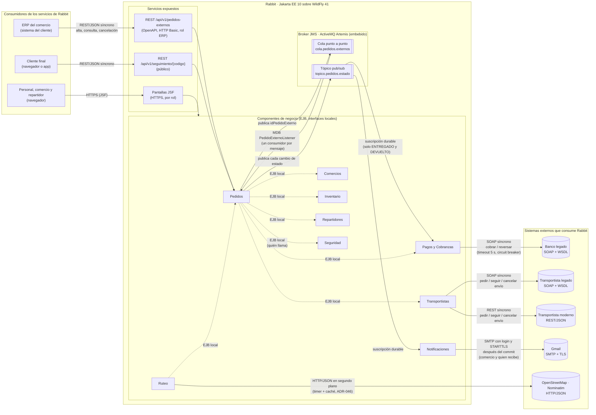
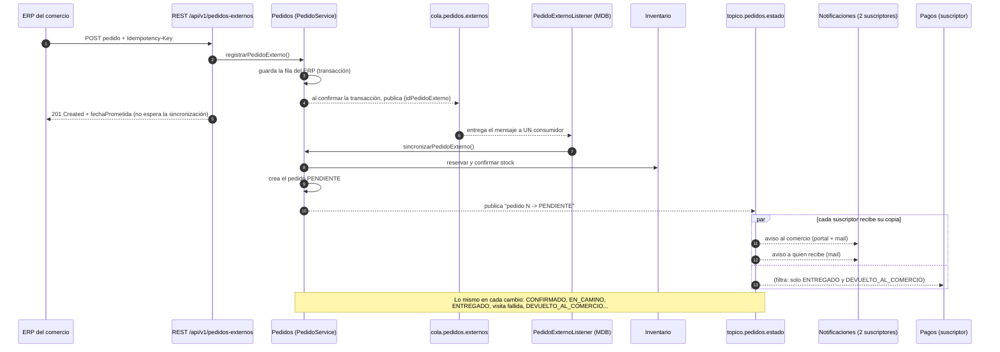

# Entrega Parcial N.º 2: arquitectura de integración

**Fecha:** 19/10/2026 · **Unidades:** IV y V

Objetivo de la consigna: definir la arquitectura de integración del
sistema y poner en marcha el primer proceso de negocio asincrónico. Este
documento junta las tres cosas que se entregan; el detalle de cada una
está en los documentos enlazados.

| Se entrega | Dónde |
|---|---|
| 1. Diagrama de arquitectura de integración (SOA) | [Sección 1](#1-diagrama-de-arquitectura-de-integración-soa) |
| 2. Clasificación justificada de cada integración externa | [Sección 2](#2-clasificación-de-cada-integración) y [MensajeriaFinal.md](../integraciones/MensajeriaFinal.md) |
| 3. Proceso de negocio de punta a punta con mensajería asincrónica real y broker configurado | [Sección 3](#3-proceso-de-negocio-asincrónico-de-punta-a-punta) y [MENSAJERIA-ASINCRONICA.md](../integraciones/MENSAJERIA-ASINCRONICA.md) |

## 1. Diagrama de arquitectura de integración (SOA)

Rabbit es un único sistema (un WAR en WildFly) partido en componentes de
negocio con interfaces explícitas. Hacia afuera expone servicios (REST) y
consume servicios de otros sistemas (SOAP, REST, SMTP); adentro, los
componentes que no necesitan esperarse se hablan por el broker JMS.

**Cómo leerlo:**

- **Flechas llenas entre Rabbit y afuera:** integraciones entre sistemas,
  con su canal (SOAP, REST, SMTP, HTTP).
- **Flechas hacia y desde el broker:** mensajería asincrónica real. El
  productor no espera al consumidor.
- **Flechas punteadas:** llamadas locales entre componentes del mismo
  proceso (EJB por interfaz). No son integraciones entre sistemas, pero
  muestran que cada componente expone un contrato y no se accede a sus
  datos por atrás.
- El banco, los transportistas y el ERP se simulan dentro del mismo WAR,
  pero se llaman **por la red** con el mismo protocolo que tendrían si
  fueran externos (el banco y el transportista legado, por su WSDL). En la
  rama `desafio-heterogeneidad` el banco corre en Node.js y el
  transportista moderno en Python (ADR-030).
- La conexión con OpenStreetMap está en la rama
  `feature/mejoras-lideres-ultima-milla` (ADR-046); el resto, también en
  `main`.

Las dependencias internas completas, una por interfaz, están en
[ARQUITECTURA.md](../arquitectura/ARQUITECTURA.md#dependencias-entre-componentes-implementadas).

## 2. Clasificación de cada integración

El criterio, en dos preguntas (desarrollado en
[MensajeriaFinal.md](../integraciones/MensajeriaFinal.md#1-el-criterio-de-decisión)):

1. **¿El que llama necesita la respuesta para seguir?** Sí → síncrona. No
   → asincrónica.
2. Si es síncrona: **¿el otro sistema expone o exige un contrato formal
   (WSDL, faults tipados)?** Sí → SOAP. No → REST. Si es asincrónica:
   **¿el mensaje lo tiene que procesar uno solo, o le interesa a varios?**
   Uno solo → cola. Varios → tópico.

| # | Integración | Tipo | Canal | Por qué |
|---|---|---|---|---|
| 1 | ERP del comercio → Rabbit: alta, consulta y cancelación de pedidos | Síncrona | **REST** | El ERP necesita saber en el momento si Rabbit aceptó el pedido (201 con fecha prometida, o 400/422 con el campo mal). Es un partner moderno: JSON, OpenAPI, idempotencia por `Idempotency-Key`. |
| 2 | Cliente final → Rabbit: seguimiento público | Síncrona | **REST** | Quiere ver el estado ya; es una consulta simple, sin contrato formal. |
| 3 | Rabbit → banco legado: cobrar y reversar | Síncrona | **SOAP** | No se puede confirmar el pedido sin saber si el cobro se aprobó. El banco es un sistema legado que publica WSDL y devuelve faults tipados (fondos insuficientes, tarjeta rechazada). |
| 4 | Rabbit → transportista legado: pedir, seguir y cancelar envíos | Síncrona | **SOAP** | Hace falta el código de seguimiento para confirmar la derivación. Sistema legado con WSDL. |
| 5 | Rabbit → transportista moderno: lo mismo | Síncrona | **REST** | Misma necesidad de respuesta; partner moderno con API JSON. |
| 6 | Alta del pedido externo → sincronización (validar comercio, reservar stock) | Asincrónica | **Cola** `cola.pedidos.externos` | El ERP no tiene por qué esperar la reserva de stock: recibe 201 y el pedido se procesa enseguida. Cada pedido se sincroniza **una sola vez**: con un tópico, varios consumidores reservarían el stock dos veces. |
| 7 | Cambio de estado del pedido → Notificaciones y Pagos | Asincrónica | **Tópico** `topico.pedidos.estado` | Pedidos no espera a que se mande un aviso o se acredite un cobro. A **varios** les interesa el mismo hecho: cada suscriptor recibe su copia (durable: si está caído, el broker se la guarda). Sumar un suscriptor (el aviso a quien recibe, ADR-040) no tocó Pedidos. |
| 8 | Rabbit → Gmail: avisos al comercio y a quien recibe | Asincrónica respecto del negocio | **SMTP** (puerto 587, login y STARTTLS) | Sale después del commit: un correo caído no frena ni deshace el cambio de estado; el aviso igual queda en el portal. SMTP es el protocolo estándar para entregar mail a cualquier casilla; Gmail exige cuenta y cifrado (ADR-047). |
| 9 | Rabbit → OpenStreetMap: ubicar direcciones para ordenar la hoja de ruta | Síncrona, pero fuera del flujo del usuario | **REST/HTTP** (Nominatim) | Es una API pública de consulta; la respuesta hace falta para guardar la coordenada. Se llama desde un timer y se guarda en caché: la pantalla del repartidor nunca espera al servicio (ADR-046). |

## 3. Proceso de negocio asincrónico de punta a punta

**Proceso:** un comercio da de alta un pedido desde su ERP y Rabbit lo
convierte en un pedido real; después, cada cambio de estado se avisa a
quien le interesa. Usa los **dos** estilos: cola punto a punto y tópico
pub/sub.

**Broker configurado:** ActiveMQ Artemis embebido en WildFly (perfil
`standalone-full.xml`). La propia aplicación declara la connection
factory y los destinos (`@JMSConnectionFactoryDefinition` y
`@JMSDestinationDefinition` en `PublicadorPedidosExternos` y
`PublicadorEstadosPedido`), con conector `in-vm`. Al desplegar, WildFly
crea la cola y el tópico; no hay que configurarlos a mano.

**Fallas que contempla:**

- **El broker no está o el mensaje se pierde:** un timer
  (`SincronizadorDePedidos`, cada minuto) busca los pedidos del ERP sin
  sincronizar y los procesa igual. La cola es el camino rápido; el
  polling, la red de contención.
- **Un consumidor está caído cuando se publica en el tópico:** las
  suscripciones son durables; el broker guarda el mensaje y se lo entrega
  al volver.
- **Mensajes desordenados en el tópico:** Notificaciones descarta un
  cambio más viejo que el último avisado, salvo el aviso de una visita
  fallida, que se avisa aunque llegue tarde (ADR-045).
- **El mismo pedido dos veces:** la `Idempotency-Key` evita el duplicado
  en el alta; la fila del ERP se lee con bloqueo, así que la cola y el
  timer no la sincronizan dos veces.

**Cómo verlo funcionando** (con WildFly levantado; detalle en
[FLUJO-DE-PRUEBAS.md](../pruebas/FLUJO-DE-PRUEBAS.md)):

1. `POST /api/v1/pedidos-externos` con un usuario ERP → `201`.
2. En el log de WildFly, en el mismo segundo:
   - `[Pedidos] Publicado en topico.pedidos.estado: pedido N -> PENDIENTE`
   - `[Notificaciones] Aviso al comercio …`
   - `[Notificaciones] Aviso al destinatario del pedido N: Recibimos tu pedido …`
3. En la consola de WildFly (`http://localhost:9990`), Runtime →
   Messaging → ActiveMQ: la cola y el tópico con sus contadores de
   mensajes.
